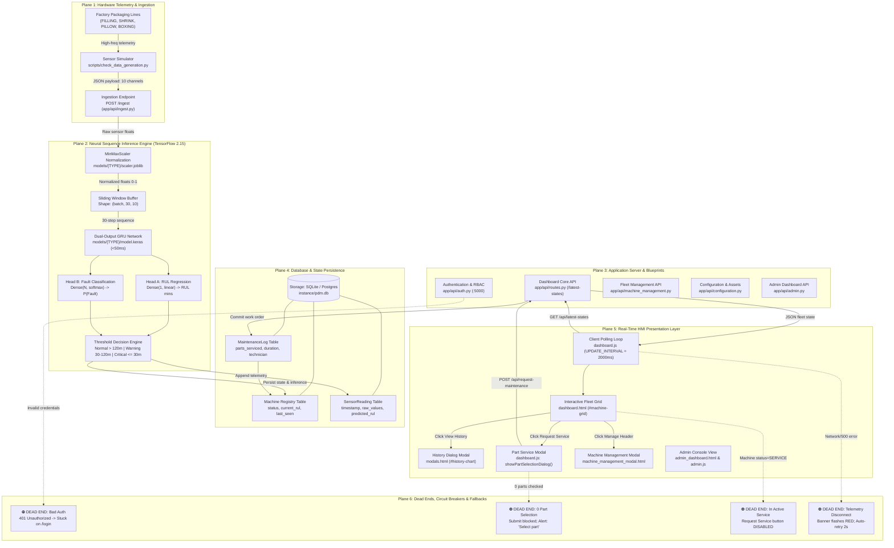
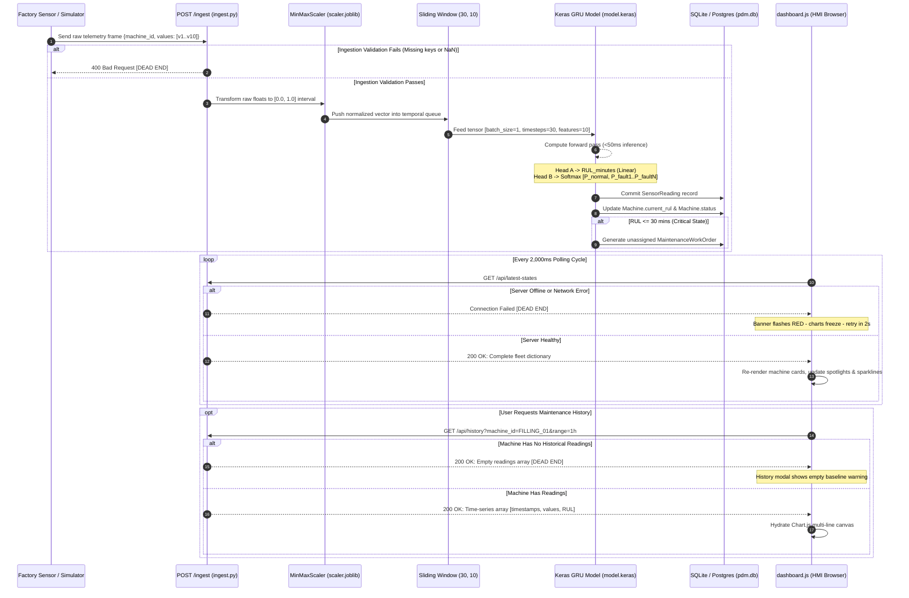
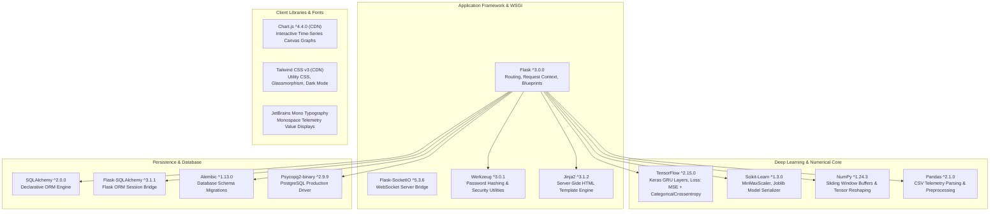

# PDM — Industrial Predictive Maintenance Platform

> Real-time industrial machine telemetry, dual-output GRU failure prediction, and maintenance scheduling platform for manufacturing lines.

---

## 📊 Project Snapshot

| Attribute | Value |
|---|---|
| **Type** | Full-stack Web App & Industrial ML System |
| **Maturity** | Active development / Feature-complete |
| **Status** | 🟢 Active |
| **Primary Language(s)** | Python 3.10+, JavaScript (ES6+), HTML5/Jinja2, CSS3 |
| **Tech Stack** | Flask 3.0, TensorFlow 2.15 (Keras), Scikit-learn, SQLAlchemy 2.0, Alembic, Tailwind CSS, Chart.js 4.4, SQLite/Postgres |
| **Last Major Update** | 2026-10-26 (Auto-synced) |
| **Estimated LOC** | ~11,330 LOC |
| **Test Coverage** | Unit & API integration tests in `scripts/test_api.py` |

---

## 🎯 The Aim

### What This Project Is
The PDM (Predictive Maintenance) Platform is an industrial automation system engineered to eliminate unscheduled downtime across manufacturing and packaging facilities. Operating across four primary industrial machinery classes—**FILLING**, **SHRINK**, **PILLOW**, and **BOXING** packaging machines—the platform continuously ingests high-frequency physical sensor vectors (temperature, vibration, motor current, pressure, flow rate, cycle speed).

Using pre-trained Gated Recurrent Unit (GRU) neural network models, the system produces dual-head inferences in under 50 milliseconds:
1. **Remaining Useful Life (RUL)**: Precise estimation of minutes or operating cycles before an impending failure.
2. **Specific Failure Classification**: Exact root-cause diagnosis (e.g., *"Nozzle Clog"* on a Filling line, *"Seal Bar Overheat"* on a Shrink wrapper, or *"Belt Misalignment"* on a Boxing machine), preventing generic "system abnormal" alerts.

### Why It Exists
Unscheduled factory downtime costs packaging and processing facilities tens of thousands of dollars per hour. Traditional maintenance models alternate between reactive firefighting (waiting for machines to seize up) and wasteful scheduled maintenance (replacing expensive components prematurely).

Generic anomaly detectors flag that a metric is abnormal but cannot tell plant mechanics which part is failing or how much operational time remains. PDM solves this by combining Mechatronics domain knowledge with multi-class sequence models to tell operators *what* is failing, *when* it will fail, and *which replacement parts* to dispatch.

### What Success Looks Like
A factory operations floor running with zero unplanned stoppages. Operators monitor high-density telemetry dashboards with real-time Chart.js visualizers. When sensor drift indicates wear, the system automatically surfaces a yellow warning (e.g., `RUL: 42 mins — Impeller Cavitation`), estimates repair duration, generates a maintenance ticket, and alerts available technicians before production stops.

### What It Is NOT
- It is **not** a generic consumer IoT dashboard; it is purpose-built for heavy discrete manufacturing packaging lines.
- It is **not** an open-ended anomaly detector; failure modes are mapped to concrete mechanical kinematics.

---

## 🏗️ Architecture Overview

[](https://ottailo.vercel.app/projects/pdm)

> 🧭 **Explore Interactively (Understand-Anything Paradigm)**:
> - **Live Portfolio Dashboard**: Explore this system in the live [Interactive AI Knowledge Graph](https://ottailo.vercel.app/projects/pdm) with node telemetry, clickable layer inspectors, live search, and dependency tracers.
> - **Offline HTML Viewer**: Open [`docs/architecture-graph.html`](./docs/architecture-graph.html) directly in any web browser with zero installation.
> - **Understand Anything CLI**: Run `/understand-dashboard` or launch the standalone zero-dependency viewer:
>   ```bash
>   npx https://github.com/Egonex-AI/Understand-Anything/releases/latest/download/understand-anything-viewer.tgz .
>   ```

### Exhaustive Multi-Plane System Architecture



[Source: `docs/diagrams/architecture.graphify`]

---

## 🧭 Exhaustive User Flow & Dead-End Map

The following map details **every user path, interactive element, form input, modal dialog, and operational dead end** across the platform.

```mermaid
graph TD
    Start([👤 User / Operator / Admin]) --> VisitLogin["Visit /login or direct view"]
    
    subgraph "Screen 1: /login (Authentication Gateway)"
        VisitLogin --> LoginForm["Input Username + Password<br/>Checkbox: Remember Me"]
        LoginForm --> BtnSignIn["🔘 [BTN] Sign In<br/>POST /auth/login"]
        BtnSignIn --> AuthDecision{Valid Credentials?}
        AuthDecision -->|No: Bad credentials| DE1["⛔ DEAD END 1: Invalid Auth<br/>Flash banner: 'Invalid username or password'<br/>User remains stuck on /login"]
        AuthDecision -->|Yes & Role == Operator| RedirectDashboard["Redirect to / (Dashboard)"]
        AuthDecision -->|Yes & Role == Admin| RedirectAdmin["Redirect to /admin/dashboard"]
        LoginForm --> LinkSetup["Link: /setup-admin"]
        LinkSetup --> SetupDecision{Admin exists in DB?}
        SetupDecision -->|Yes| DE2["⛔ DEAD END 2: Setup Locked<br/>403 Forbidden: Admin already initialized"]
        SetupDecision -->|No| CreateAdminForm["Create root admin account"]
    end

    subgraph "Screen 2: / (Operator Fleet Dashboard)"
        RedirectDashboard --> DashboardView["Render dashboard.html"]
        DashboardView --> HeaderControls["Top Header Controls"]
        HeaderControls --> BtnManageHeader["🔘 [BTN] Manage -> Opens Machine Mgmt Modal"]
        HeaderControls --> LinkAdmin["🔗 [LNK] Admin Dashboard -> Redirect to /admin"]
        HeaderControls --> LinkLogout["🔗 [LNK] Logout -> Destroys session -> /login"]

        DashboardView --> SidebarFilters["Sidebar Controls (sidebar.html)"]
        SidebarFilters --> SelectLocation["Select: #filter-location (Plant Location)"]
        SidebarFilters --> SelectType["Select: #filter-type (FILLING, SHRINK, PILLOW, BOXING)"]
        SidebarFilters --> BtnClearFilters["🔘 [BTN] Clear Filters (Resets dropdowns to All)"]
        SelectLocation --> FilterEval{Matching machines > 0?}
        SelectType --> FilterEval
        FilterEval -->|No match| DE3["⛔ DEAD END 3: Empty Filter Match<br/>Grid renders empty: 'No machines found'<br/>User MUST click Clear Filters to recover"]
        FilterEval -->|Yes| RenderGrid["Render Fleet Grid (#machine-grid)"]
        
        SidebarFilters --> BtnTabWatchlist["🔘 [BTN] Tab: Watchlist (Sort by lowest TTF)"]
        SidebarFilters --> BtnTabLog["🔘 [BTN] Tab: Event Log (Chronological alerts)"]

        RenderGrid --> MachineCard["Machine Card Component<br/>Interactive mouse spotlight<br/>Status: Normal, Warning, Critical, Service<br/>Telemetry sparklines"]
        MachineCard --> BtnViewHistory["🔘 [BTN] View History"]
        MachineCard --> BtnRequestService["🔘 [BTN] Request Service"]
        MachineCard --> ServiceStatusCheck{Machine already in service?}
        ServiceStatusCheck -->|Status == UNDER_MAINTENANCE| DE5["⛔ DEAD END 5: Service in Progress<br/>Request Service button is DISABLED<br/>Badge: 'Service in Progress'"]
        ServiceStatusCheck -->|Status != UNDER_MAINTENANCE| OpenPartModal["Open Part Selection Modal"]
    end

    subgraph "Screen 3: History Modal Dialog (#history-modal-overlay)"
        BtnViewHistory --> OpenHistoryModal["Open Modal & fetchHistory(machineId, '1h')"]
        OpenHistoryModal --> BtnCloseHistory["🔘 [BTN] Close &times; (Destroys chart instance)"]
        OpenHistoryModal --> BtnRange1h["🔘 [BTN] Last 1 Hour (GET /api/history?range=1h)"]
        OpenHistoryModal --> BtnRange6h["🔘 [BTN] Last 6 Hours (GET /api/history?range=6h)"]
        OpenHistoryModal --> BtnRange24h["🔘 [BTN] Last 24 Hours (GET /api/history?range=24h)"]
        BtnRange1h --> HistoryDataCheck{Telemetry exists?}
        BtnRange6h --> HistoryDataCheck
        BtnRange24h --> HistoryDataCheck
        HistoryDataCheck -->|Zero rows returned| DE4["⛔ DEAD END 4: No Telemetry History<br/>New machine with 0 ticks<br/>Chart renders empty baseline warning"]
        HistoryDataCheck -->|Rows returned| RenderChart["Render Multi-line Chart.js Canvas"]
    end

    subgraph "Screen 4: Part Service Modal (#part-selection-modal)"
        OpenPartModal --> PartModalForm["Render dynamic parts checklist by machine type:<br/>FILLING: Nozzles (30m), Pump (45m), Sensors (15m)<br/>SHRINK: Heaters (40m), Belt (35m), Temp (20m)<br/>PILLOW: Jaws (50m) | BOXING: Pneumatics (35m)"]
        PartModalForm --> ServiceInputs["Inputs: Service Notes textarea<br/>Auto-calculated estimated repair time"]
        PartModalForm --> BtnCancelService["🔘 [BTN] Cancel (Closes modal without changes)"]
        PartModalForm --> BtnConfirmService["🔘 [BTN] Confirm Service Request<br/>POST /api/request-maintenance"]
        BtnConfirmService --> PartValidation{Selected checkboxes >= 1?}
        PartValidation -->|0 checkboxes selected| DE6["⛔ DEAD END 6: Zero Parts Selected<br/>Submission blocked<br/>Alert banner: 'Please select at least one component'"]
        PartValidation -->|>= 1 parts selected| ServiceSuccess["Update status -> UNDER_MAINTENANCE<br/>Reset RUL to 100%<br/>Append event to Log<br/>Close modal"]
    end

    subgraph "Screen 5: Machine Management Modal (machine_management_modal.html)"
        BtnManageHeader --> MgmtModalView["Open Modal: Tab bar"]
        MgmtModalView --> TabMachines["🔘 [BTN] Tab: 🏭 Machines"]
        MgmtModalView --> TabTraining["🔘 [BTN] Tab: 📊 Training Data"]
        MgmtModalView --> TabStreaming["🔘 [BTN] Tab: 📡 Data Streaming"]

        TabMachines --> FormRegister["Form: Register Machine<br/>Inputs: ID, Name, Serial, Location, Dropdown Type"]
        FormRegister --> BtnSubmitRegister["🔘 [BTN] 🚀 Register Machine<br/>POST /api/machine-mgmt/machines"]
        BtnSubmitRegister --> RegValidation{Valid & Unique Serial?}
        RegValidation -->|Duplicate Serial or Missing Fields| DE7["⛔ DEAD END 7: Registration Rejected<br/>409 Conflict / 400 Bad Request<br/>Inline validation banner displayed"]
        RegValidation -->|Valid| MachineCreated["Append to fleet table & update UI"]

        TabTraining --> BtnBrowseCSV["🔘 [BTN] Browse Files (Select CSV log)"]
        BtnBrowseCSV --> BtnUploadTrain["🔘 [BTN] Upload & Train"]
        BtnUploadTrain --> TrainValidation{Valid CSV format & columns?}
        TrainValidation -->|Wrong columns or corrupt file| DE9["⛔ DEAD END 9: Invalid Training Data<br/>422 Unprocessable Entity<br/>Training worker rejected"]
        TrainValidation -->|Valid| TrainLaunched["Background retrain job initiated"]

        TabStreaming --> SelectSource["Select: Data Source (Simulated, Live, Playback)"]
        SelectSource --> BtnToggleStream["🔘 [BTN] Start / Stop Streaming"]
    end

    subgraph "Screen 6: Admin Dashboard (/admin/dashboard)"
        RedirectAdmin --> AdminViewGrid["Render admin_dashboard.html"]
        AdminViewGrid --> TabUsers["🔘 [BTN] Tab: User Management"]
        AdminViewGrid --> TabConfig["🔘 [BTN] Tab: Configuration"]
        AdminViewGrid --> TabHealth["🔘 [BTN] Tab: System Health"]
        
        TabUsers --> BtnAddUser["🔘 [BTN] + Add User (Opens Modal)"]
        BtnAddUser --> FormAddUser["Inputs: Username, Email, Password, Dropdown Role"]
        FormAddUser --> BtnCreateUser["🔘 [BTN] Create User (POST /api/admin/users)"]
        BtnCreateUser --> UserValidation{Username/Email Available?}
        UserValidation -->|Duplicate| DE10["⛔ DEAD END 10: Duplicate User<br/>400 Bad Request error banner"]
        UserValidation -->|Available| UserCreated["User record inserted"]

        TabUsers --> BtnDeleteUser["🔘 [BTN] Delete User (with ID)"]
        BtnDeleteUser --> DeleteSelfCheck{Target ID == Active Admin Session?}
        DeleteSelfCheck -->|Yes| DE11["⛔ DEAD END 11: Self-Deletion Forbidden<br/>403 Forbidden: Cannot delete active admin account"]
        DeleteSelfCheck -->|No| UserDeleted["User removed from database"]

        AdminViewGrid --> LinkBackDashboard["🔗 [LNK] Back to Dashboard -> Redirect to /"]
    end
```



🔍 *[Open Full-Screen Zoomable Diagram (SVG)](./docs/diagrams/user-flow.svg)*


---

## 🗂️ File Structure

### Exhaustive File Tree

```
PDM/
├── debug_app.py                 # Diagnostic route tester
├── docker-compose.yml           # Container deployment (Web + PostgreSQL)
├── manage.py                    # Database migration & CLI management entry
├── PDM_SYSTEM_ANALYSIS.md       # Comprehensive 770-line technical deep dive
├── README.md                    # This master documentation
├── requirements.txt             # Python dependencies (Flask, TF, SQLAlchemy)
├── run.py                       # Production application runner (2,033 LOC)
├── server_output.log            # Server execution log
├── update.md                    # Migration & update changelog
├── docs/
│   └── diagrams/               # Visual architecture & graphify assets
│       ├── architecture.graphify
│       ├── architecture.png
│       ├── file-tree.graphify
│       ├── file-tree.png
│       ├── dependencies.graphify
│       ├── dependencies.png
│       ├── data-flow.graphify
│       ├── data-flow.png
│       ├── user-flow.graphify
│       ├── user-flow.png
│       ├── connection-map.graphify
│       └── connection-map.png
├── app/
│   ├── packages.py              # Packaging line domain constants
│   ├── __init__.py              # App factory, DB init, blueprint registration
│   ├── api/                     # REST API Blueprints
│   │   ├── admin.py             # User admin, system stats, admin dashboard
│   │   ├── auth.py              # Login, logout, setup-admin
│   │   ├── configuration.py     # Equipment templates, assets, locations
│   │   ├── dashboard.py         # Fleet KPIs, alert aggregation
│   │   ├── ingest.py            # Telemetry ingestion endpoint
│   │   ├── machine_management.py# Companies, machines, sensors CRUD
│   │   └── routes.py            # Latest states, history, maintenance dispatch
│   ├── config/                  # App environment configs
│   ├── models/                  # SQLAlchemy ORM models (Machine, SensorReading, Log)
│   ├── services/                # Model inference runner & feature scaler
│   ├── static/                  # Client assets
│   │   ├── css/style.css
│   │   └── js/
│   │       ├── admin.js         # User CRUD & admin tab management
│   │       ├── configuration.js # Equipment templates & asset CRUD
│   │       ├── dashboard.js     # Core client loop: polling, cards, history, service modals (1,259 LOC)
│   │       └── machine_management.js # Machine registration & sensor config
│   └── templates/               # Jinja2 HTML views
│       ├── admin_dashboard.html # Admin console view
│       ├── base.html            # Master layout wrapper
│       ├── dashboard.html       # Fleet monitoring grid
│       ├── login.html           # Authentication form
│       └── components/
│           ├── header.html      # Top navigation & KPI summary
│           ├── machine_management_modal.html # Machine CRUD & streaming modal
│           ├── modals.html      # History dialog with Chart.js canvas
│           └── sidebar.html     # Location/Type filters & watchlist
├── instance/
│   └── pdm.db                   # SQLite local database
├── migrations/                  # Alembic database migration scripts
├── models/                      # Pre-trained ML model artifacts
│   ├── BOXING/                  # Case packer models & scaler.joblib
│   ├── Filling/                 # Liquid filler models & scaler.joblib
│   ├── Pillow/                  # Horizontal wrapper models & scaler.joblib
│   └── Shrink/                  # Thermal shrink tunnel models & scaler.joblib
└── scripts/                     # Utility scripts & simulators
    ├── check_data_generation.py # Synthetic sensor stream generator (10Hz)
    ├── create_basic_models.py   # Baseline GRU model training script
    ├── populate_machines.py     # Default fleet seeder
    ├── seed_v2_config.py        # Equipment template seeder
    └── test_api.py              # Automated REST API test suite
```

---

## 🧩 The Logic & Data Pipeline

### Exhaustive Data Flow & Transformation Pipeline



---

## 🔌 Connection Map & Integration Interfaces

### Exhaustive Connection & Integration Map

```mermaid
graph TB
    subgraph "External Telemetry Sources"
        HardwareLine["Physical Machine Lines<br/>(RS485 / Modbus / MQTT)"]
        Simulator["Simulated Industrial Stream<br/>scripts/check_data_generation.py"]
    end

    subgraph "Flask Application Core (:5000)"
        AppFactory["app/__init__.py: create_app()"]
        IngestBP["POST /ingest"]
        RoutesBP["/api/latest-states<br/>/api/history<br/>/api/request-maintenance"]
        AuthBP["/auth/login<br/>/auth/logout<br/>/auth/setup-admin"]
        MgmtBP["/api/machine-mgmt/machines<br/>/api/machine-mgmt/sensors"]
        ConfigBP["/api/config/templates<br/>/api/config/assets"]
        AdminBP["/admin/dashboard<br/>/api/admin/users"]
    end

    subgraph "ML Model Graphs (models/)"
        FillingModel["Filling/model.keras + scaler.joblib"]
        ShrinkModel["Shrink/model.keras + scaler.joblib"]
        PillowModel["Pillow/model.keras + scaler.joblib"]
        BoxingModel["Boxing/model.keras + scaler.joblib"]
    end

    subgraph "Persistence Store"
        SQLiteDB[(instance/pdm.db<br/>Development SQLite)]
        PostgresDB[(PostgreSQL 14+ RDS<br/>Production DATABASE_URL)]
        Migrations["Alembic Migrations<br/>migrations/versions/"]
    end

    subgraph "Client Presentation & Cross-Project"
        BrowserClient["Plant Operator Browser<br/>dashboard.js + Chart.js 4.4"]
        AdminClient["Plant Admin Browser<br/>admin.js + Tailwind CSS"]
        PortfolioCaseStudy["Cross-Project Consumer:<br/>projects/ottailo-portfolio<br/>(Mechatronics AI Showcase)"]
    end

    HardwareLine -->|Telemetry stream| IngestBP
    Simulator -->|Telemetry stream| IngestBP
    AppFactory --> IngestBP
    AppFactory --> RoutesBP
    AppFactory --> AuthBP
    AppFactory --> MgmtBP
    AppFactory --> ConfigBP
    AppFactory --> AdminBP

    IngestBP --> FillingModel
    IngestBP --> ShrinkModel
    IngestBP --> PillowModel
    IngestBP --> BoxingModel

    RoutesBP --> SQLiteDB
    RoutesBP --> PostgresDB
    AuthBP --> SQLiteDB
    MgmtBP --> SQLiteDB
    ConfigBP --> SQLiteDB
    AdminBP --> SQLiteDB
    Migrations --> SQLiteDB

    RoutesBP <-->|HTTP Polling 2s| BrowserClient
    AdminBP <-->|HTTP REST| AdminClient
    BrowserClient -.->|Case Study Reference| PortfolioCaseStudy
```



🔍 *[Open Full-Screen Zoomable Diagram (SVG)](./docs/diagrams/connection-map.svg)*


---

## 📦 Exhaustive Dependencies Hierarchy



🔍 *[Open Full-Screen Zoomable Diagram (SVG)](./docs/diagrams/edge-telemetry-pipeline.svg)*


---

## 🚀 Setup & Execution Guide

### Prerequisites
- Python 3.10 or 3.11 64-bit
- Virtual environment (`venv`)

### 1. First-Time Setup
```bash
# 1. Navigate to PDM directory
cd PDM

# 2. Initialize virtual environment
python -m venv .venv
source .venv/bin/activate  # Windows: .venv\Scripts\activate

# 3. Install dependencies
pip install -r requirements.txt

# 4. Apply database migrations & seed machines
python manage.py db upgrade
python scripts/populate_machines.py
```

### 2. Running Application & Telemetry Simulator
```bash
# Terminal 1: Launch Application Server (Port 5000)
python run.py

# Terminal 2: Launch Live Synthetic Telemetry Stream
python scripts/check_data_generation.py
```

### 3. Accessing Endpoints
- **HMI Fleet Dashboard**: `http://localhost:5000/`
- **Admin Console**: `http://localhost:5000/admin/dashboard`
- **Initial Setup**: `http://localhost:5000/setup-admin`

---

## 📝 Document Meta
- **Generated:** 2026-09-13
- **Last Verified Current:** 2026-10-26
- **Verification Frequency:** Bi-annually or upon model retraining.
